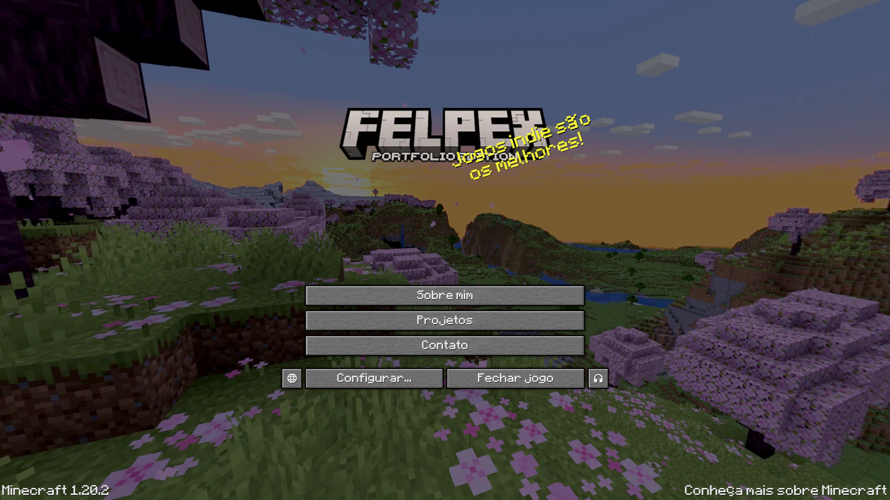
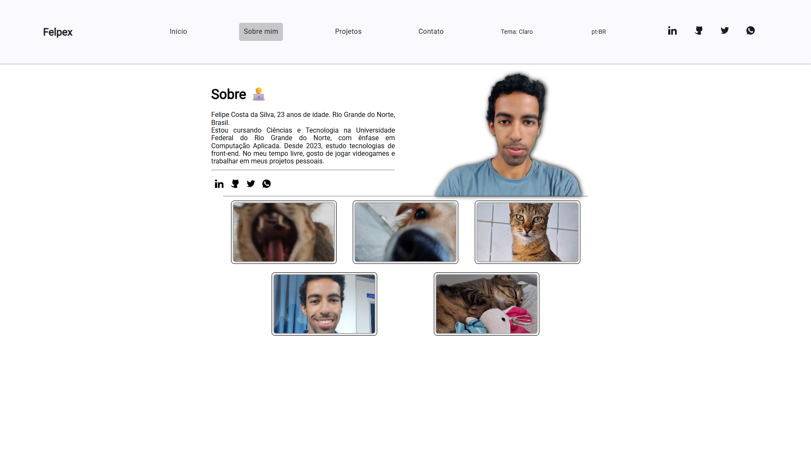
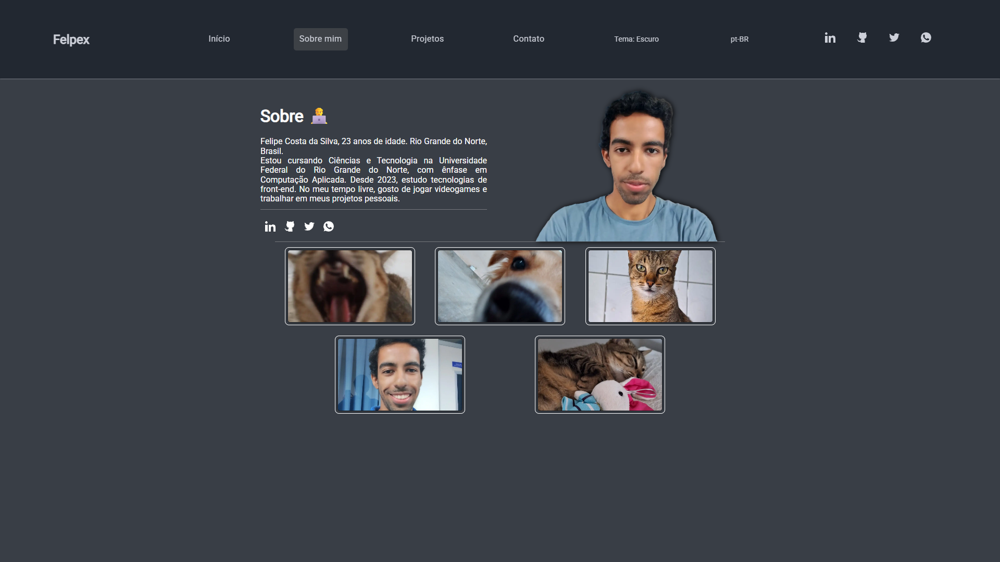
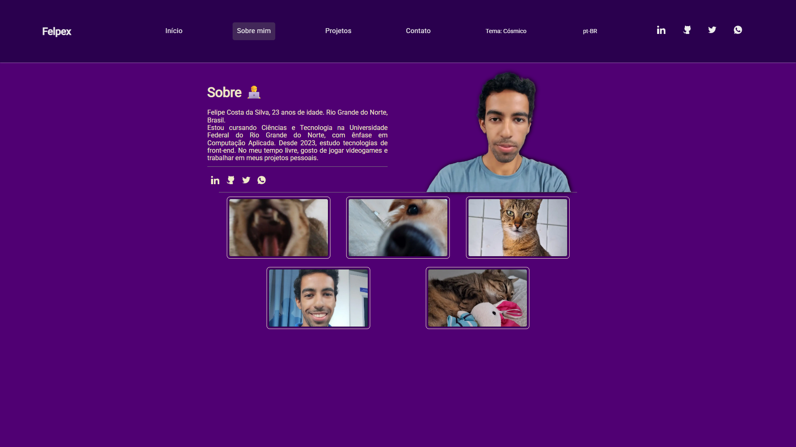
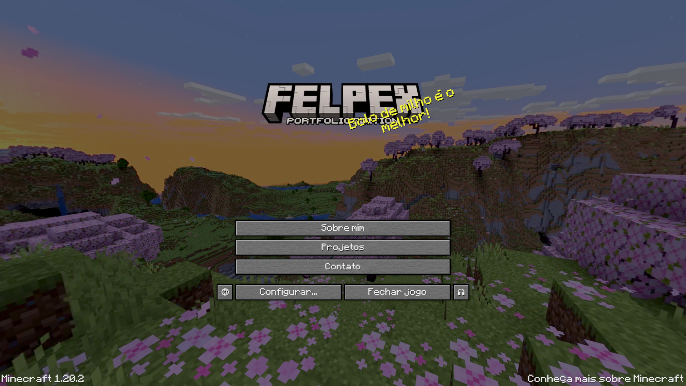
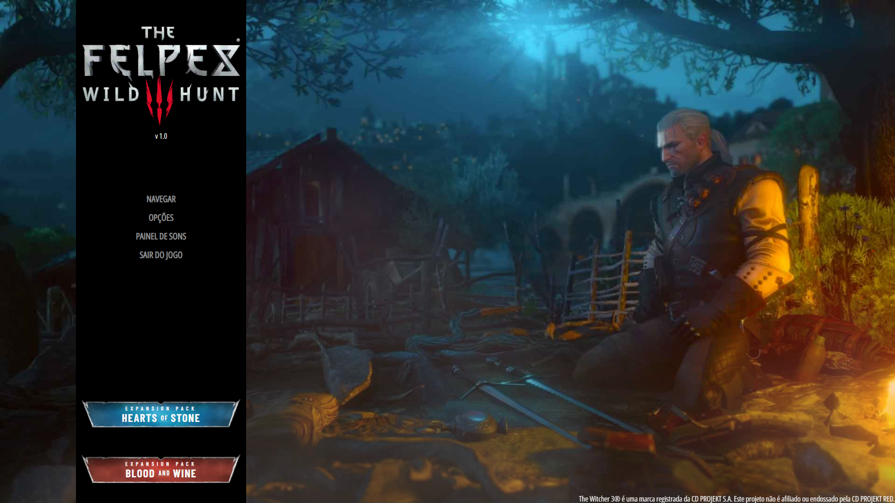
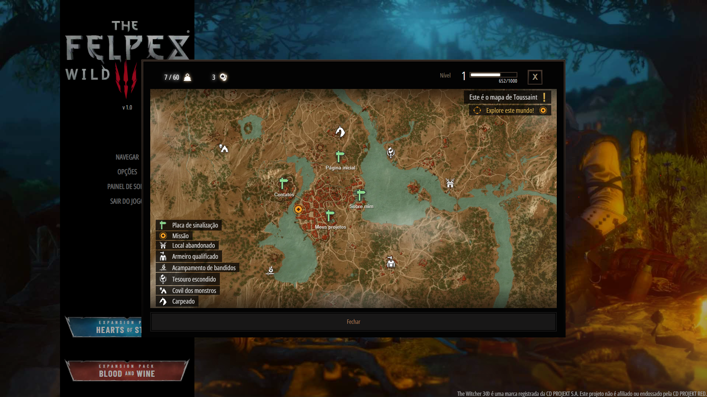
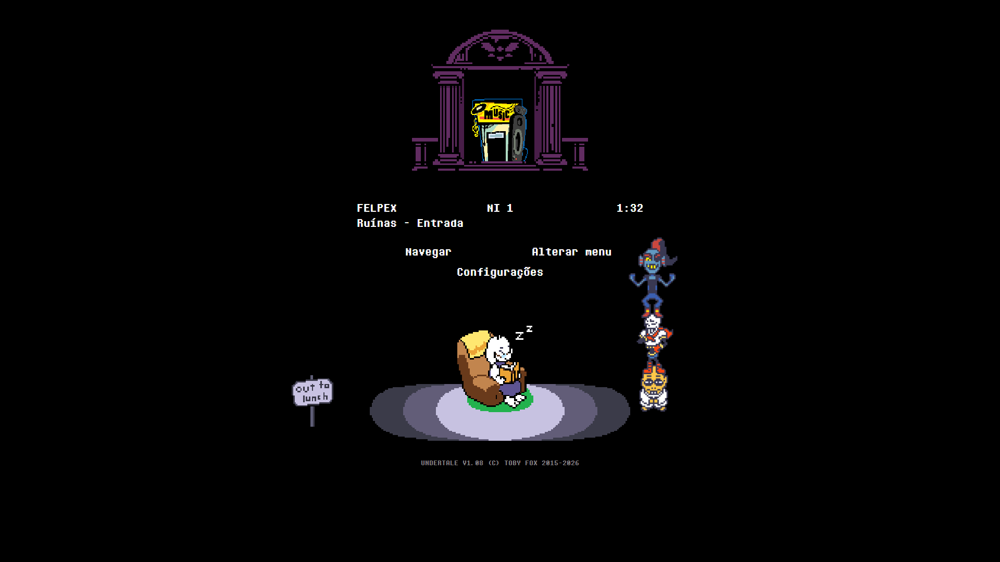
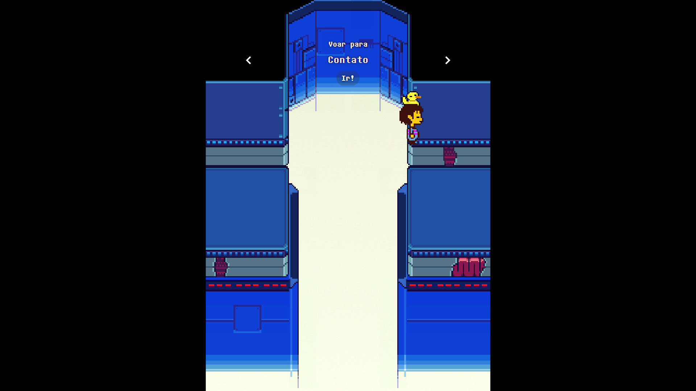
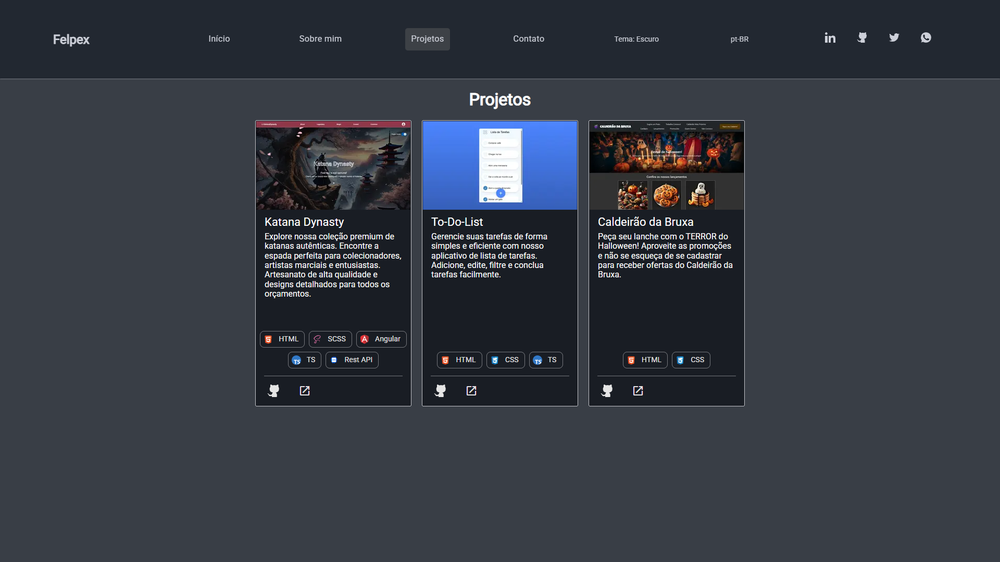

# 🎮 Felpex — Web Dev Portfolio

Personal portfolio of **Felipe Costa (Felpex)**, built with **Angular 19 + TypeScript** and fully **themed**: besides the traditional color themes (Light, Dark and Cosmic), the site has **video game–inspired themes**, where the _Home_ page is recreated as the **main menu of the referenced game**, complete with music, sound effects, animations and easter eggs.

> A study project and showcase: Angular front-end, animations, audio, WebGL (three.js), particles, interactive maps, pixel-art sprites and internationalization.

<p align="center">
  
</p>

**Current version:** `1.6.2`

🇧🇷 [Leia em português](./README.md)

---

## 📑 Table of Contents

- [Overview](#-overview)
- [Themes](#-themes)
  - [Theme status](#-theme-status)
  - [Color themes](#-color-themes-done)
  - [Minecraft](#-minecraft--done)
  - [The Witcher 3](#-the-witcher-3--done)
  - [Undertale](#-undertale--done)
  - [Planned themes](#-planned-themes)
- [Pages](#-pages)
- [General features](#-general-features)
- [Tech stack](#-tech-stack)
- [Architecture and folder structure](#-architecture-and-folder-structure)
- [Services](#-services)
- [Running the project](#-running-the-project)
- [Creating a new game theme](#-creating-a-new-game-theme)
- [Roadmap](#-roadmap)
- [Legal notice](#-legal-notice)
- [Author](#-author)

---

## 🌟 Overview

The site works like a regular portfolio (Home, About me, Projects and Contact), but users can switch the **theme** at any time. Each theme changes:

- 🎨 **Color palette** (generated with `ng generate @angular/material:theme-color` and applied via `mat.theme`);
- 🔤 **Typography** (each game's own fonts);
- 🧭 **Header/navigation** (a different component per theme);
- 🏠 **Home page** (in game themes, it becomes the game's start menu);
- 🔊 **Audio** (soundtrack, click and hover SFX);
- ✨ **Easter egg** when clicking the logo;
- 🖱️ **Visual details** (buttons, cards, dialogs, cursor, backgrounds).

The selected theme and language are saved in `localStorage`, so your choice persists between visits.

---

## 🎨 Themes

### 📊 Theme status

| Theme                                                              | Type   | Status     |
| ------------------------------------------------------------------ | ------ | ---------- |
| Light                                                              | Colors | ✅ Done    |
| Dark                                                               | Colors | ✅ Done    |
| Cosmic                                                             | Colors | ✅ Done    |
| Minecraft                                                          | Game   | ✅ Done    |
| The Witcher 3                                                      | Game   | ✅ Done    |
| Undertale                                                          | Game   | ✅ Done    |
| Red Dead Redemption 2, Zelda, Persona 3, Elden Ring, Hollow Knight | Game   | 📝 Planned |

---

### 🌈 Color themes (done)

| Theme      | Description                                                                |
| ---------- | -------------------------------------------------------------------------- |
| **Light**  | Default light theme, using Angular Material's `azure` and `blue` palettes. |
| **Dark**   | Dark blue-gray tones (`#222831`, `#393E46`) with cyan/blue accents.        |
| **Cosmic** | Deep purple tones (`#2A004E`, `#500073`) with cream text, "space" look.    |

Clicking the active theme again switches back to the default (Light) and shows a snackbar.

<table>
  <tr>
    <td align="center"><b>Light</b></td>
    <td align="center"><b>Dark</b></td>
    <td align="center"><b>Cosmic</b></td>
  </tr>
  <tr>
    <td></td>
    <td></td>
    <td></td>
  </tr>
</table>

---

### ⛏️ Minecraft — ✅ Done

Theme inspired by the **Minecraft 1.20** start menu.

<p align="center">
  
</p>

**Home (`MinecraftHomeComponent`)**

- 🌄 **3D panoramic skybox** (three.js) slowly rotating in the background, using the 6 faces of the game's panorama.
- 🟩 **Menu with Minecraft-style buttons**: _About me_, _Projects_, _Contact me_, _Quit game_, _Options_, plus side buttons for language and soundboard.
- 💬 **Random phrases** next to the logo (the famous _splash texts_), translated into pt-BR and en-US.
- 📋 Version text and copyright at the bottom.
- 📱 Responsive mobile layout.

**Header (`MinecraftHeaderComponent`)**

- Navigation bar with a block texture.
- Cascading menus: _Explore_ (routes) and _Settings_ (themes, languages, soundboard).
- Side menu and soundboard drawers on mobile.

**Dialogs**

- Theme options (games and colors) with expansion panels and radio buttons.
- Language selection.
- Soundboard with music controls and SFX/music volume.
- All with Minecraft "pixel art" style buttons and borders.

**Easter egg 💣**

- Click the logo to **light a TNT**: the block falls, flashes white and explodes with **particles** (`tsparticles`), along with activation and explosion sounds.

**Audio**

- Soundtrack: _Aria Math_, _Mice on Venus_, _Subwoofer Lullaby_, _Moog City_ (C418) and _Pigstep_ (Lena Raine).

---

### 🐺 The Witcher 3 — ✅ Done

Theme inspired by the start menu and UI of **The Witcher 3: Wild Hunt**.

<p align="center">
  
</p>

**Home (`Tw3HomeComponent`)**

- 🌫️ **three.js effects**: animated 2D fog, a campfire with pulsing light, glow, flames and sparks as particles with custom shaders. The fire position adapts when the window is resized.
- 📜 **Side menu** in Witcher style: _Navigate_, _Options_, _Soundboard_ and _Quit game_, with decorated corners and hover animation.
- 🏷️ **Expansion badges** for _Hearts of Stone_ and _Blood and Wine_.
- 🖱️ **Custom cursor** on the home page.
- ©️ Copyright link.

**Home dialogs**

- 🗺️ **Navigate**: an **interactive map** (Leaflet) with in-game icons. _Fast travel points_ take you to the site's routes (_home_, _about-me_, _projects_, _contact-me_), and there are decorative icons (quest, monster den, armorer, etc.) with translated tooltips. A game-style HUD legend is included.
- ⚙️ **Options**: submenu navigation (game/color themes, volume, languages), with level/XP bar, weight and money as HUD elements.
- 🃏 **Soundboard / Music Player**: songs are **Gwent cards**. Selecting a card makes it **fly to the player** with a _FLIP_ animation, and the music plays with a progress bar, composer name and controls (previous, play/pause, next).

<p align="center">
  
</p>

**Header (`Tw3HeaderComponent`)**

- Circular page navigation with arrows (previous/next) showing the next route's name.
- **Themes**, **Volume** and **Languages** buttons with game icons.
- Side menu and soundboard drawers on mobile.

**Easter egg 🔥**

- Click the logo to cast the **Igni** sign: a rain of fire particles (`tsparticles`), a full-screen red/gold glow and SFX.

**Audio**

- Soundtrack: _Kaer Morhen_, _Silver For Monsters..._, _... Steel For Humans_, _The Fields of Ard Skellig_ and _Drink Up, There's More!_.

---

### 💛 Undertale — ✅ Done

Theme inspired by the start menu and UI of **Undertale**: black background, _Determination Mono_ font, pixel-art sprites (`image-rendering: pixelated`) and a yellow (`#fafc13`) hover highlight. Menus, alt texts and button tooltips are fully translated (pt-BR and en-US).

<p align="center">
  
</p>

**Home (`UndertaleHomeComponent`)**

- 🚪 **Main menu** with the door, a "save file" style info block (name **FELPEX**, **LV 1**, time and location _Ruins - Entrance_) and the _Navigate_, _Change Menu_ and _Settings_ buttons. The soundboard icon next to the door is also clickable.
- 🎭 **6 scene variations**, picked at random on each load: _Ruins_ (Flowey), _Snowdin_ (Toriel), _Waterfall_ (Papyrus and Sans), _Hotland_ (Undyne, Papyrus and Sans), _Core_ (Alphys, Undyne and Papyrus) and _The End_ (all characters together).
- 🔁 The **Change Menu** button switches to the next variation, and each one plays its own _Start Menu Music_ (6 tracks).
- ⚡ Variations are loaded on demand with dynamic `import()` (_lazy loading_).
- 🙈 The header is hidden on the Home (like in the other game themes) and restored when leaving.
- ©️ Footer with a game-style copyright text.

**Navigate — Frisk's flight** (`UndertaleHomeNavigationComponent`)

- Frisk is carried by the bird that _"carries you over a disproportionately small gap"_. Use the arrows to pick a destination, click **Go!** and watch the flight.
- Each game area is a page of the site: **Snowdin → Home**, **Waterfall → Projects**, **Hotland → About-me** and **The Core → Contact-me**.
- Each area has its own background and music (_Snowy_, _Quiet Water_, _Another Medium_ and _CORE_), and the bird's theme plays during the flight.

<p align="center">
  
</p>

**Settings** (`UndertaleHomeConfigComponent`)

- _SETTINGS_ screen with **EXIT**, **LANGUAGE** (toggles between en-US and pt-BR) and **CHANGE THEME** (opens the themes dialog).
- 🍂 **Season of the year**: the background gets particles according to the season in Brazil (snow in winter, leaves in autumn and spring, sun in summer), and the music changes along with it (_Uwa!! So Holiday_, _Temperate_ or _HEATS!!_).
- 🐶 The "annoying dog" shows up with a different sprite and phrase for each season.

**Soundboard**

- Opens by clicking the icon next to the door, with the _Sound Studio_ track in the background.
- Playlist with 10 tracks (_Bonetrousle_, _Megalovania_, _Hopes And Dreams_, _Death By Glamour_, _It's Raining Somewhere Else_, _Respite_, _Finale_, among others).
- Player with song name, composer, progress bar, previous/play-pause/next and music and SFX volume sliders.

**Themes dialog**

- Dialog with a white border and game-style text: pick the type (_Games_ or _Colors_) and then the theme.

**Header (`UndertaleHeaderComponent`)**

- Black gradient bar, links to _Home_, _About-me_, _Projects_ and _Contact-me_, the Undertale logo in the center and a mobile menu.
- Corner buttons **♪ (Soundboard)** and **⚙ (Settings)** that go back to the Home and directly open the matching menu (`goToMenu`), with translated tooltips and click/hover SFX.
- On mobile: a routes menu and a `more_vert` menu with _Soundboard_ and _Config_.

**Easter egg 💜 — souls finale**

- Click the logo to trigger the **finale**: the 6 souls (dark blue, green, light blue, orange, purple and yellow) **orbit the red soul** for ~21.5 s, to the finale music.
- At regular intervals each soul **attacks** the red soul; when it lands, the red soul is **healed** with a heal SFX and a screen flash.
- Responsive orbit radius, translated alt texts and automatic stop when navigating to another route.

**Audio**

- Soundtrack by Toby Fox: _Start Menu Music 1–5 and Full_, _Uwa!! So Holiday / Temperate / HEATS!!_, _Sound Studio_, _Snowy_, _Quiet Water_, _Another Medium_, _CORE_, among others.
- SFX for click, hover, entering the settings, attack/heal and the easter egg finale sound.

---

### 🔮 Planned themes

The names are already reserved in `models/themes.ts` (currently commented out in `gamesOptions`):

| Game                  | Status       | Notes                                         |
| --------------------- | ------------ | --------------------------------------------- |
| Red Dead Redemption 2 | 📝 Planned   | "Wild West" style, menu inspired by the game. |
| The Legend of Zelda   | 📝 Planned   | Still deciding between _BOTW_ and _TOTK_.     |
| Persona 3             | 🤔 Undecided | Might become _Persona 5_.                     |
| Elden Ring            | 🤔 Undecided | Might become _Dark Souls_.                    |
| Hollow Knight         | 📝 Planned   |                                               |

---

## 📄 Pages

| Route         | Page     | Description                                                                                                                                                                                                         |
| ------------- | -------- | ------------------------------------------------------------------------------------------------------------------------------------------------------------------------------------------------------------------- |
| `/home`       | Home     | Introduction with a typing effect (_typed.js_) and navigation cards. **In the Minecraft, Witcher 3 and Undertale themes it becomes the game menu** (`HomeWrapperComponent` picks the component based on the theme). |
| `/about-me`   | About me | Introduction text, photo, social links and a photo gallery with a **full-screen dialog**.                                                                                                                           |
| `/projects`   | Projects | Project cards with image, description, _hard skills_ (chips with SVG icons), hover overlay and links.                                                                                                               |
| `/contact-me` | Contact  | Reactive form with progressive validation (fields appear as the previous ones are filled), sending via **EmailJS**, and quick alternatives (copy email/phone with snackbar).                                        |
| `**`          | 404      | "Not found" page with a button back to home.                                                                                                                                                                        |

<p align="center">
  
</p>

### 💼 Showcased projects

- **Katana Dynasty** — Angular, SCSS, TypeScript, Rest API.
- **To-Do-List** — HTML, CSS, TypeScript (course final project, OOP).
- **Caldeirão da Bruxa** — HTML, CSS (Bootstrap).

---

## ⚙️ General features

- 🌐 **Internationalization** (pt-BR and en-US) with `@ngx-translate`, detecting the browser language and saving the preference.
- 🎵 **Custom audio system** (`AudioService`) built on the **Web Audio API**: playlists, SFX, separate (music/SFX) persisted volumes, pause/resume, next/previous and progress.
- 🎚️ **Soundboard**: floating panel on desktop (only in themes without their own soundboard, i.e. the color themes) and a drawer on mobile. Minecraft, Witcher 3 and Undertale have theirs inside the menu itself.
- 📱 **Responsive**: mobile breakpoint at `820px` (`ResponsiveService`), with a side menu and bottom sheets for themes and languages.
- ⏳ **Global loading screen** between navigations, integrated with page animations.
- 🎞️ **Angular Animations** (fade, translate, list stagger, dynamic input height, "open from center" in Undertale).
- 🔔 **Custom snackbars** for feedback (theme/language change, contact copy, email sending).
- 🏷️ **Dynamic tab title** based on route and language.
- ♿ Translated alt texts on images and `aria-label` on buttons.
- 💾 Theme, language and volume persistence in `localStorage`.

---

## 🛠️ Tech stack

| Category           | Technologies                                                                         |
| ------------------ | ------------------------------------------------------------------------------------ |
| **Framework**      | Angular 19 (standalone components, new `@if`/`@for`/`@switch` control flow, signals) |
| **Language**       | TypeScript 5.6                                                                       |
| **Styling**        | SCSS, Angular Material 19 + CDK (Material 3 theming)                                 |
| **i18n**           | `@ngx-translate/core` + `http-loader`                                                |
| **3D / Graphics**  | three.js                                                                             |
| **Particles**      | tsParticles (`@tsparticles/angular`)                                                 |
| **Maps**           | Leaflet                                                                              |
| **Text animation** | typed.js                                                                             |
| **Email**          | emailjs-com                                                                          |
| **Reactivity**     | RxJS, signals, ngxtension                                                            |
| **Testing**        | Jasmine + Karma                                                                      |

---

## 🗂️ Architecture and folder structure

```
src/
├── app/
│   ├── config/                    # ngx-translate configuration
│   ├── logo-effects/              # Dynamic logo + per-theme easter eggs
│   │   └── effects/Games/         # Minecraft (TNT), The Witcher 3 (Igni) and Undertale (souls)
│   ├── models/                    # Interfaces and data (themes, musics, SFX, projects, photos)
│   ├── pages/
│   │   ├── home/                  # home-wrapper + default home (intro-section, navigation-cards)
│   │   ├── about-me/              # first-half, second-half, photos-footer
│   │   ├── projects/              # project-card, overlay-projects
│   │   ├── contact-me/            # form + aside
│   │   └── page-not-found/
│   ├── services/                  # audio, theme, language, loading, responsive, mobile menus
│   ├── shared/
│   │   ├── animations/            # Reusable triggers (includes games/undertale-animations)
│   │   └── components/            # header, mobile-menu, soundboard, loading, snackbar, social-links
│   └── themes/
│       ├── colors/                # Color theme styles (light, dark, cosmic)
│       ├── games/
│       │   ├── pages/
│       │   │   ├── minecraft/         # minecraft-home (+ dialogs)
│       │   │   ├── the-witcher-3/     # tw3-home (+ effects and dialogs)
│       │   │   └── undertale/
│       │   │       └── undertale-home/
│       │   │           ├── variations/                 # ruins-flowey, snowdin-toriel, waterfall-papyrus,
│       │   │           │                               # hotland-undyne, core-alphys, the-end
│       │   │           ├── undertale-home-navigation/  # Frisk + bird flight
│       │   │           ├── undertale-home-config/      # settings with seasons of the year
│       │   │           ├── undertale-home-soundboard/
│       │   │           └── dialogs/                    # themes dialog
│       │   ├── shared/components/ # Headers and dialogs for each game
│       │   └── styles/            # Each theme's SCSS + palettes + fonts + cursors
│       └── styles-variables/
├── assets/                        # Images, fonts, sounds, icons, i18n (pt-BR.json / en-US.json)
├── reset.scss
└── styles.scss                    # Imports all themes

public/                            # Extra static files (also served as assets)
docs/screenshots/                  # Screenshots used in this README
```

### 🧠 How theme switching works

1. `ThemeService` keeps the current theme in a `BehaviorSubject` and saves it to `localStorage`.
2. On change, it adds the class `theme-name-theme` to `<body>` (e.g. `body.undertale-theme`) and removes the other themes' classes.
3. Each `_theme-*.scss` file writes its styles inside `body.<theme>-theme` and calls `mat.theme(...)` with its palette.
4. `AppComponent` renders the theme's **header** via `NgComponentOutlet` (`themeService.getHeaderComponent()`, with one `case` per game theme).
5. `HomeWrapperComponent` picks the theme's **home** also via `NgComponentOutlet`.
6. `LogoEffectsComponent` loads the logo and easter egg for the current theme.

---

## 🧩 Services

| Service                                                | Responsibility                                                                    |
| ------------------------------------------------------ | --------------------------------------------------------------------------------- |
| `ThemeService`                                         | Current theme, theme lists, theme switching, header selection, feedback snackbar. |
| `AudioService`                                         | Web Audio API: SFX, playlists, volumes, progress, play/pause/next/prev.           |
| `LanguageService`                                      | Supported languages, saved/detected language and language switching.              |
| `LoadingService`                                       | Global loading state during navigations.                                          |
| `ResponsiveService`                                    | `isMobile$` observable (≤ 820px) with debounce.                                   |
| `MobileNavMenuService` / `MobileSoundboardMenuService` | Control of the mobile drawers (menu and soundboard).                              |

---

## 🚀 Running the project

**Prerequisites:** Node.js `^18.19`, `^20.11` or `>=22`, and npm.

```bash
# 1. Clone the repository
git clone https://github.com/oFelpex/WebDevPortfolio.git
cd WebDevPortfolio

# 2. (Optional) If the Undertale theme is not on master yet, use its branch
git checkout feature/custom-theme_undertale

# 3. Install dependencies
npm install

# 4. Run in development
npm start        # or: ng serve
# Open http://localhost:4200/

# 5. Production build
npm run build

# 6. Unit tests
npm test
```

### 📜 Available scripts

| Script          | Description                                   |
| --------------- | --------------------------------------------- |
| `npm start`     | Development server.                           |
| `npm run build` | Production build in `dist/web-dev-portfolio`. |
| `npm run watch` | Build in watch mode (development).            |
| `npm test`      | Tests with Karma + Jasmine.                   |

---

## ➕ Creating a new game theme

1. **Register the theme** in `src/app/models/themes.ts` (uncomment/add it in `gamesOptions`).
2. **Create the palette** in `themes/games/styles/angular-colors-and-fonts/_theme-<game>-colors.scss` (with `ng generate @angular/material:theme-color`) and declare the fonts with `@font-face`.
3. **Create the style** `themes/games/styles/_theme-<game>.scss` with `body.<game>-theme { ... }` and `@include mat.theme(...)`; import it in `src/styles.scss`.
4. **Create the header** in `themes/games/shared/components/<game>/` and register it in `ThemeService.getHeaderComponent()`.
5. **Create the home** in `themes/games/pages/<game>/` and register it in the `switch` of `HomeWrapperComponent`.
6. **Create the easter egg** in `logo-effects/effects/Games/<Game>/` and add it to `LogoEffectsComponent` (`playEffect` and `@switch`).
7. **Add audio** in `models/musics.ts` and `models/sfxs.ts` (click, hover, easter egg and playlist).
8. **Add assets** (logo, backgrounds, buttons, sprites, cursor, fonts, sounds) in `src/assets/themes/games/<game>/` and `src/assets/sounds/games/<game>/`.
9. **Translate** the new keys in `assets/i18n/pt-BR.json` and `en-US.json`.
10. If the theme has its own soundboard, **add its name to the `themesWithoutSoundboard` list** in `app.component.ts` (Minecraft, Witcher 3 and Undertale are already there).

---

## 🗺️ Roadmap

### ✅ Done

- [x] Base structure with Angular 19 and standalone components
- [x] Home, About me, Projects, Contact and 404 pages
- [x] Color themes: Light, Dark and Cosmic
- [x] pt-BR / en-US internationalization
- [x] Audio system, playlists and soundboard
- [x] Complete **Minecraft** theme (3D home, header, dialogs, TNT)
- [x] Contact form with EmailJS
- [x] Responsive layout with mobile menus
- [x] Complete **The Witcher 3** theme (three.js home, Leaflet map, Gwent cards, header and Igni)
- [x] Complete **Undertale** theme (home with 6 variations, flight navigation, seasonal settings, soundboard, themes dialog, working header buttons, souls easter egg and translations)

### 🔜 Next steps

- [ ] New game themes (RDR2, Zelda, Persona, Elden Ring, Hollow Knight)
- [ ] Write real tests (current `.spec.ts` files are just the CLI-generated ones, and some imports need fixing)
- [ ] Move EmailJS keys/IDs to environment variables
- [ ] Migrate `emailjs-com` (deprecated) to `@emailjs/browser`
- [ ] Lazy loading of routes and heavy themes (three.js, Leaflet, tsParticles) to shrink the initial bundle (the Undertale variations already use dynamic `import()`)
- [ ] Optimize images and audio (load on demand)
- [ ] Accessibility: keyboard navigation in custom menus and theme contrast
- [ ] _Hard skills_ / experience section and more projects

---

## ⚖️ Legal notice

This is a **non-profit** project made for study and portfolio purposes. All names, brands, logos, music, images, sprites and other materials from **Minecraft** (Mojang Studios / Microsoft), **The Witcher 3** (CD PROJEKT RED) and **Undertale** (Toby Fox) belong to their respective owners. This project is not affiliated with, sponsored by or endorsed by them.

---

## 👨‍💻 Author

**Felipe Costa — Felpex**
Programming student focused on **Front-end (Angular + TypeScript)**, aiming to also work in **game development (C# and C++)**.

- 💼 [LinkedIn](https://www.linkedin.com/in/felpex/)
- 🐙 [GitHub](https://github.com/oFelpex/)
- 🐦 [X / Twitter](https://x.com/Felpex_br)
- 💬 [WhatsApp](https://whatsa.me/5584987095902)

---

<p align="center">Made with 💜, Angular and a lot of gaming nostalgia.</p>
