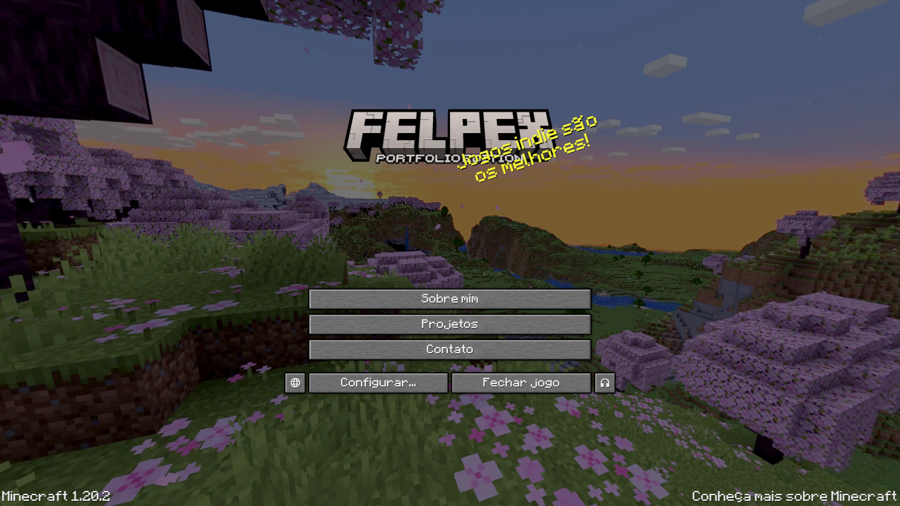
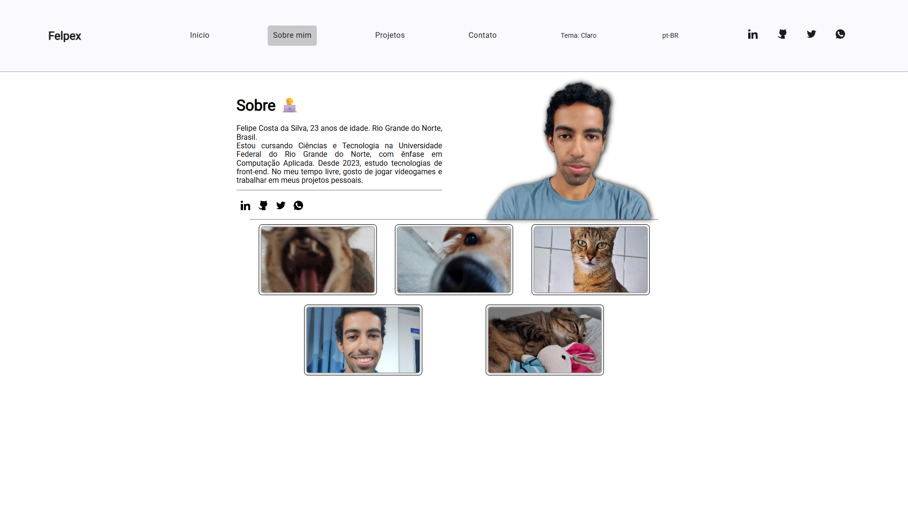
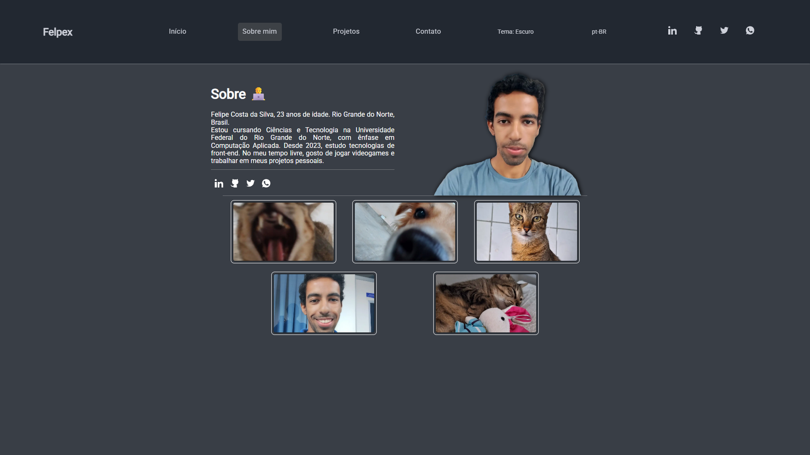
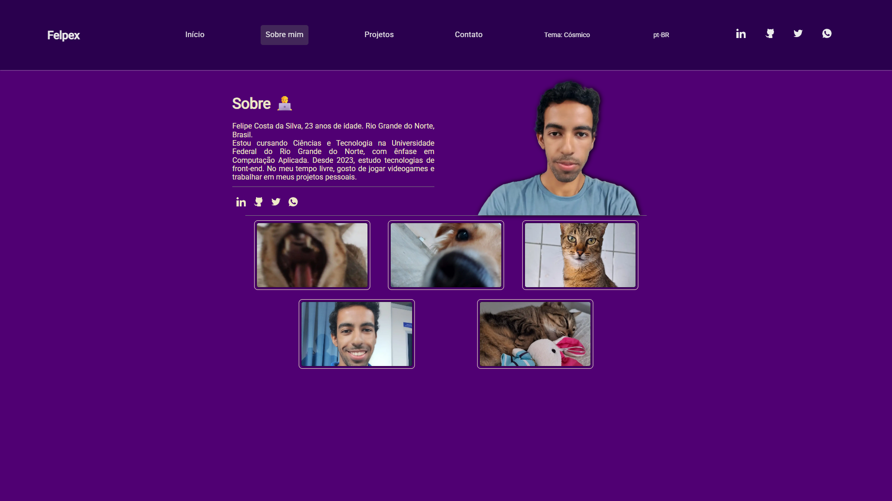
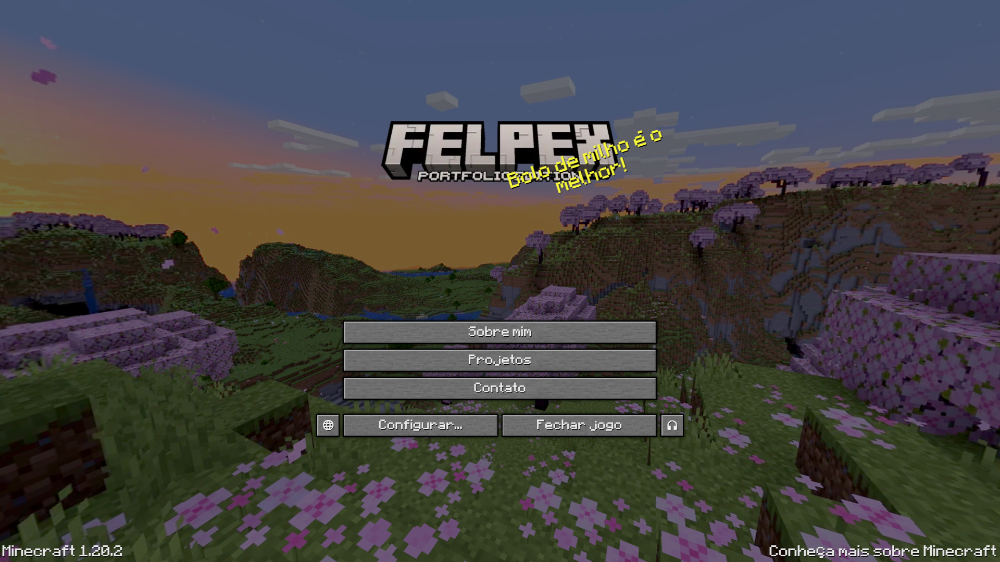
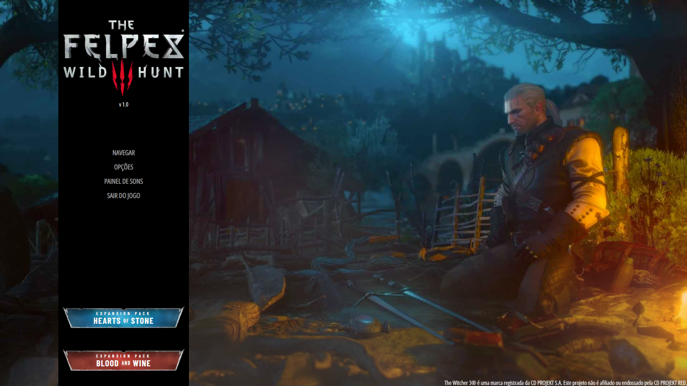
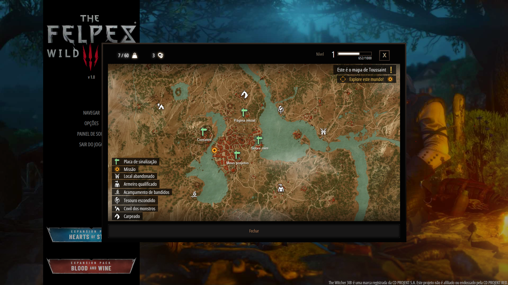
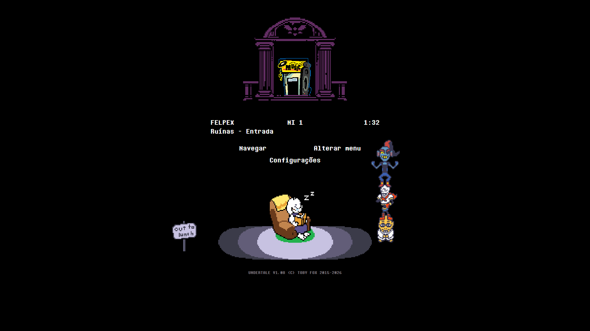
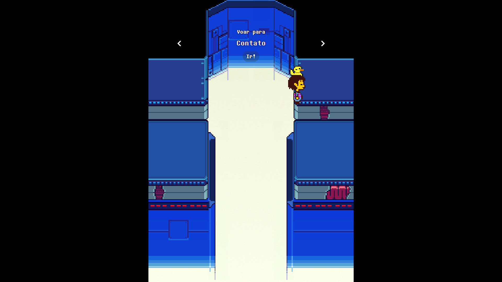
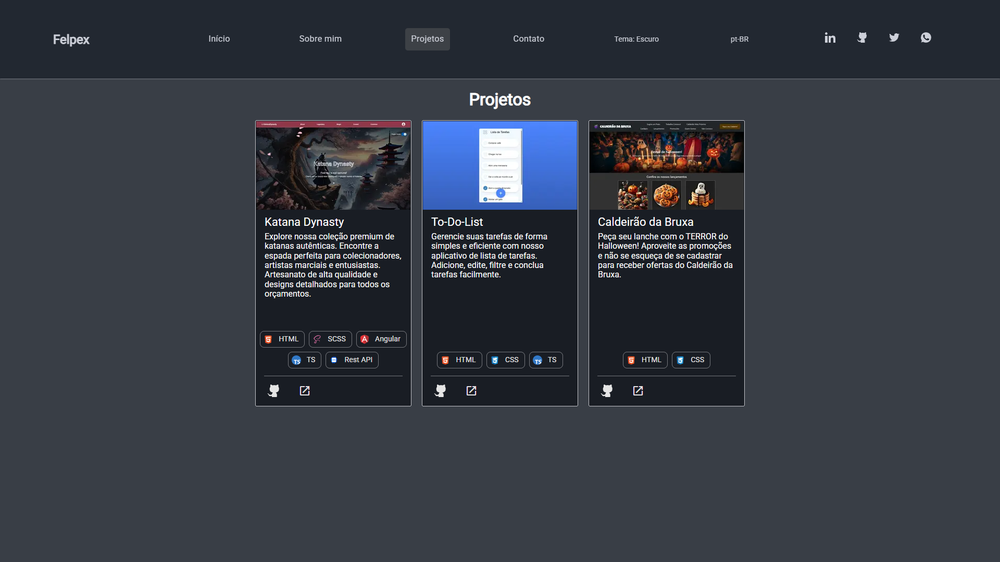

# 🎮 Felpex — Web Dev Portfolio

Portfólio pessoal de **Felipe Costa (Felpex)**, desenvolvido com **Angular 19 + TypeScript** e totalmente **tematizado**: além dos temas de cores tradicionais (Light, Dark e Cosmic), o site possui **temas inspirados em jogos de videogame**, onde a página _Home_ é recriada como o **menu inicial do jogo** referido, com música, efeitos sonoros, animações e easter eggs.

> Projeto feito como estudo e vitrine: front-end com Angular, animações, áudio, WebGL (three.js), partículas, mapas interativos, sprites em pixel art e internacionalização.

<p align="center">
  
</p>

**Versão atual:** `1.6.1`

🇺🇸 [Read in English](./README.en.md)

---

## 📑 Sumário

- [Visão geral](#-visão-geral)
- [Temas](#-temas)
  - [Status dos temas](#-status-dos-temas)
  - [Temas de cores](#-temas-de-cores-concluídos)
  - [Minecraft](#-minecraft--concluído)
  - [The Witcher 3](#-the-witcher-3--concluído)
  - [Undertale](#-undertale--concluído)
  - [Temas planejados](#-temas-planejados)
- [Páginas](#-páginas)
- [Funcionalidades gerais](#-funcionalidades-gerais)
- [Tecnologias](#-tecnologias)
- [Arquitetura e estrutura de pastas](#-arquitetura-e-estrutura-de-pastas)
- [Serviços](#-serviços)
- [Como rodar o projeto](#-como-rodar-o-projeto)
- [Como criar um novo tema de jogo](#-como-criar-um-novo-tema-de-jogo)
- [Roadmap](#-roadmap)
- [Aviso legal](#-aviso-legal)
- [Autor](#-autor)

---

## 🌟 Visão geral

O site funciona como um portfólio comum (Home, Sobre mim, Projetos e Contato), mas o usuário pode trocar o **tema** a qualquer momento. Cada tema altera:

- 🎨 **Paleta de cores** (gerada via `ng generate @angular/material:theme-color` e aplicada com `mat.theme`);
- 🔤 **Tipografia** (fontes próprias de cada jogo);
- 🧭 **Header/navegação** (componente diferente por tema);
- 🏠 **Página Home** (nos temas de jogo, vira o menu inicial do jogo);
- 🔊 **Áudio** (trilha sonora, SFX de clique e de hover);
- ✨ **Easter egg** ao clicar no logo;
- 🖱️ **Detalhes visuais** (botões, cards, diálogos, cursor, fundos).

O tema escolhido e o idioma ficam salvos no `localStorage`, então a escolha é mantida entre visitas.

---

## 🎨 Temas

### 📊 Status dos temas

| Tema                                                               | Tipo  | Status        |
| ------------------------------------------------------------------ | ----- | ------------- |
| Light                                                              | Cores | ✅ Concluído  |
| Dark                                                               | Cores | ✅ Concluído  |
| Cosmic                                                             | Cores | ✅ Concluído  |
| Minecraft                                                          | Jogo  | ✅ Concluído  |
| The Witcher 3                                                      | Jogo  | ✅ Concluído  |
| Undertale                                                          | Jogo  | ✅ Concluído  |
| Red Dead Redemption 2, Zelda, Persona 3, Elden Ring, Hollow Knight | Jogo  | 📝 Planejados |

---

### 🌈 Temas de cores (concluídos)

| Tema       | Descrição                                                                           |
| ---------- | ----------------------------------------------------------------------------------- |
| **Light**  | Tema padrão, claro, usando as paletas `azure` e `blue` do Angular Material.         |
| **Dark**   | Tons de cinza-azulado escuro (`#222831`, `#393E46`) com destaque em ciano/azul.     |
| **Cosmic** | Tons de roxo profundo (`#2A004E`, `#500073`) com texto em creme, visual "espacial". |

Ao clicar novamente no tema ativo, o site volta para o tema padrão (Light) e exibe um snackbar informando.

<table>
  <tr>
    <td align="center"><b>Light</b></td>
    <td align="center"><b>Dark</b></td>
    <td align="center"><b>Cosmic</b></td>
  </tr>
  <tr>
    <td></td>
    <td></td>
    <td></td>
  </tr>
</table>

---

### ⛏️ Minecraft — ✅ Concluído

Tema inspirado no menu inicial do **Minecraft 1.20**.

<p align="center">
  
</p>

**Home (`MinecraftHomeComponent`)**

- 🌄 **Skybox panorâmico 3D** (three.js) girando lentamente ao fundo, com as 6 faces do panorama oficial do jogo.
- 🟩 **Menu com botões estilo Minecraft**: _About me_, _Projects_, _Contact me_, _Quit game_, _Options_ e botões laterais de idioma e soundboard.
- 💬 **Frases aleatórias** ao lado do logo (as famosas _splash texts_), traduzidas em pt-BR e en-US.
- 📋 Texto de versão e copyright no rodapé.
- 📱 Versão responsiva para mobile.

**Header (`MinecraftHeaderComponent`)**

- Barra de navegação com textura de bloco.
- Menus em cascata: _Explore_ (rotas) e _Settings_ (temas, idiomas, soundboard).
- Menu lateral e soundboard em _drawer_ no mobile.

**Diálogos**

- Opções de tema (jogos e cores) com expansion panels e radio buttons.
- Seleção de idioma.
- Soundboard com controle de música, volume de SFX e música.
- Todos com botões e bordas em estilo "pixel art" do Minecraft.

**Easter egg 💣**

- Clique no logo para **ativar um TNT**: o bloco cai, pisca em branco, e explode com **partículas** (`tsparticles`), acompanhado dos sons de ativação e explosão.

**Áudio**

- Trilha: _Aria Math_, _Mice on Venus_, _Subwoofer Lullaby_, _Moog City_ (C418) e _Pigstep_ (Lena Raine).

---

### 🐺 The Witcher 3 — ✅ Concluído

Tema inspirado no menu inicial e na interface do **The Witcher 3: Wild Hunt**.

<p align="center">
  
</p>

**Home (`Tw3HomeComponent`)**

- 🌫️ **Efeitos com three.js**: neblina animada (fog 2D), fogueira com luz pulsante, brilho (_glow_), chamas e fagulhas em partículas com shaders customizados. A posição da fogueira se adapta ao redimensionar a tela.
- 📜 **Menu lateral** estilo Witcher: _Navigate_, _Options_, _Soundboard_ e _Quit game_, com cantos decorados e animação de hover.
- 🏷️ **Badges das expansões** _Hearts of Stone_ e _Blood and Wine_.
- 🖱️ **Cursor personalizado** na home.
- ©️ Link de copyright.

**Diálogos da Home**

- 🗺️ **Navigate**: um **mapa interativo** (Leaflet) com ícones do jogo. Os _fast travel points_ levam às rotas do site (_home_, _about-me_, _projects_, _contact-me_), e há ícones decorativos (missão, monster den, armeiro, etc.) com tooltips traduzidos. HUD com legenda no estilo do jogo.
- ⚙️ **Options**: navegação por submenus (temas de jogos/cores, volume, idiomas), com barra de nível/XP, peso e dinheiro como elementos de HUD.
- 🃏 **Soundboard / Music Player**: as músicas são **cartas de Gwent**. Ao selecionar uma carta, ela **voa até o player** com animação _FLIP_, e a música toca com barra de progresso, compositor e controles (anterior, play/pause, próxima).

<p align="center">
  
</p>

**Header (`Tw3HeaderComponent`)**

- Navegação circular entre páginas com setas (anterior/próxima) mostrando o nome da próxima rota.
- Botões de **Temas**, **Volume** e **Idiomas** com ícones do jogo.
- Menu lateral e soundboard em _drawer_ no mobile.

**Easter egg 🔥**

- Clique no logo para lançar o sinal **Igni**: chuva de partículas de fogo (`tsparticles`), brilho vermelho/dourado em tela cheia e SFX.

**Áudio**

- Trilha: _Kaer Morhen_, _Silver For Monsters..._, _... Steel For Humans_, _The Fields of Ard Skellig_ e _Drink Up, There's More!_.

---

### 💛 Undertale — ✅ Concluído

Tema inspirado no menu inicial e na interface do **Undertale**: fundo preto, fonte _Determination Mono_, sprites em pixel art (`image-rendering: pixelated`) e destaque em amarelo (`#fafc13`) no hover. Menus, textos alternativos e dicas de botões são totalmente traduzidos (pt-BR e en-US).

<p align="center">
  
</p>

**Home (`UndertaleHomeComponent`)**

- 🚪 **Menu principal** com a porta, o bloco de informações no estilo "arquivo de save" (nome **FELPEX**, **LV 1**, tempo e local _Ruins - Entrance_) e os botões _Navigate_, _Change Menu_ e _Settings_. O ícone do soundboard, ao lado da porta, também é clicável.
- 🎭 **6 variações da cena**, sorteadas a cada carregamento: _Ruins_ (Flowey), _Snowdin_ (Toriel), _Waterfall_ (Papyrus e Sans), _Hotland_ (Undyne, Papyrus e Sans), _Core_ (Alphys, Undyne e Papyrus) e _The End_ (todos os personagens juntos).
- 🔁 O botão **Change Menu** troca para a próxima variação, e cada uma toca a sua própria _Start Menu Music_ (6 faixas).
- ⚡ As variações são carregadas sob demanda, com `import()` dinâmico (_lazy loading_).
- 🙈 O header é escondido na Home (como nos outros temas de jogo) e restaurado ao sair.
- ©️ Rodapé com o texto de copyright no estilo do jogo.

**Navigate — voo do Frisk** (`UndertaleHomeNavigationComponent`)

- O Frisk é carregado pelo pássaro que _"carries you over a disproportionately small gap"_. Use as setas para escolher o destino, clique em **Go!** e assista ao voo.
- Cada área do jogo é uma página do site: **Snowdin → Home**, **Waterfall → Projects**, **Hotland → About-me** e **The Core → Contact-me**.
- Fundo e música próprios por área (_Snowy_, _Quiet Water_, _Another Medium_ e _CORE_), e o tema do pássaro toca durante o voo.

<p align="center">
  
</p>

**Settings** (`UndertaleHomeConfigComponent`)

- Tela _SETTINGS_ com **EXIT**, **LANGUAGE** (alterna entre en-US e pt-BR) e **CHANGE THEME** (abre o diálogo de temas).
- 🍂 **Estação do ano**: o fundo ganha partículas conforme a estação no Brasil (neve no inverno, folhas no outono e na primavera, sol no verão), e a música muda junto (_Uwa!! So Holiday_, _Temperate_ ou _HEATS!!_).
- 🐶 O "cachorro irritante" aparece com um sprite e uma frase diferentes para cada estação.

**Soundboard**

- Abre ao clicar no ícone ao lado da porta, com a trilha _Sound Studio_ ao fundo.
- Playlist com 10 faixas (_Bonetrousle_, _Megalovania_, _Hopes And Dreams_, _Death By Glamour_, _It's Raining Somewhere Else_, _Respite_, _Finale_, entre outras).
- Player com nome da música, compositor, barra de progresso, anterior/play-pause/próxima e sliders de volume de música e de SFX.

**Diálogo de temas**

- Diálogo com borda branca e texto no estilo do jogo: escolha o tipo (_Games_ ou _Colors_) e depois o tema.

**Header (`UndertaleHeaderComponent`)**

- Barra preta com gradiente, links para _Home_, _About-me_, _Projects_ e _Contact-me_, logo do Undertale no centro e menu mobile.
- Botões de canto **♪ (Soundboard)** e **⚙ (Settings)** que levam de volta à Home e abrem direto o respectivo menu (`goToMenu`), com dicas (_tooltips_) traduzidas e SFX de clique e hover.
- No mobile: menu de rotas e menu `more_vert` com _Soundboard_ e _Config_.

**Easter egg 💜 — finale das almas**

- Clique no logo para disparar o **finale**: as 6 almas (azul-escuro, verde, azul-claro, laranja, roxa e amarela) **orbitam a alma vermelha** durante ~21,5 s, ao som da música de finale.
- A cada intervalo, cada alma **ataca** a alma vermelha; ao acertar, ela é **curada** com um SFX de cura e um flash na tela.
- Raio da órbita responsivo, textos alternativos traduzidos e encerramento automático ao navegar para outra rota.

**Áudio**

- Trilha de Toby Fox: _Start Menu Music 1–5 e Full_, _Uwa!! So Holiday / Temperate / HEATS!!_, _Sound Studio_, _Snowy_, _Quiet Water_, _Another Medium_, _CORE_, entre outras.
- SFX de clique, de hover, de entrada nas configurações, de ataque/cura e o efeito sonoro do finale do easter egg.

---

### 🔮 Temas planejados

Os nomes já estão previstos em `models/themes.ts` (por enquanto comentados em `gamesOptions`):

| Jogo                  | Status       | Observação                                    |
| --------------------- | ------------ | --------------------------------------------- |
| Red Dead Redemption 2 | 📝 Planejado | Estilo "Velho Oeste", menu inspirado no jogo. |
| The Legend of Zelda   | 📝 Planejado | Ainda decidindo entre _BOTW_ e _TOTK_.        |
| Persona 3             | 🤔 Em dúvida | Pode virar _Persona 5_.                       |
| Elden Ring            | 🤔 Em dúvida | Pode virar _Dark Souls_.                      |
| Hollow Knight         | 📝 Planejado |                                               |

---

## 📄 Páginas

| Rota          | Página    | Descrição                                                                                                                                                                                                  |
| ------------- | --------- | ---------------------------------------------------------------------------------------------------------------------------------------------------------------------------------------------------------- |
| `/home`       | Home      | Apresentação com efeito de digitação (_typed.js_) e cards de navegação. **Nos temas Minecraft, Witcher 3 e Undertale, vira o menu do jogo** (`HomeWrapperComponent` escolhe o componente conforme o tema). |
| `/about-me`   | Sobre mim | Texto de apresentação, foto, links sociais e galeria de fotos com **diálogo de tela cheia**.                                                                                                               |
| `/projects`   | Projetos  | Cards de projetos com imagem, descrição, _hard skills_ (chips com ícones SVG), overlay de hover e links.                                                                                                   |
| `/contact-me` | Contato   | Formulário reativo com validação progressiva (os campos aparecem conforme os anteriores são preenchidos), envio por **EmailJS**, e alternativas rápidas (copiar e-mail/telefone com snackbar).             |
| `**`          | 404       | Página "não encontrada" com botão para voltar à home.                                                                                                                                                      |

<p align="center">
  
</p>

### 💼 Projetos exibidos

- **Katana Dynasty** — Angular, SCSS, TypeScript, Rest API.
- **To-Do-List** — HTML, CSS, TypeScript (projeto final de curso, POO).
- **Caldeirão da Bruxa** — HTML, CSS (Bootstrap).

---

## ⚙️ Funcionalidades gerais

- 🌐 **Internacionalização** (pt-BR e en-US) com `@ngx-translate`, detectando o idioma do navegador e salvando a preferência.
- 🎵 **Sistema de áudio próprio** (`AudioService`) com **Web Audio API**: playlists, SFX, volumes separados (música/SFX) persistidos, pausar/retomar, próxima/anterior e progresso.
- 🎚️ **Soundboard**: painel flutuante no desktop (apenas nos temas sem soundboard próprio, ou seja, nos temas de cores) e _drawer_ no mobile. Minecraft, Witcher 3 e Undertale têm o seu dentro do próprio menu.
- 📱 **Responsivo**: ponto de quebra mobile em `820px` (`ResponsiveService`), com menu lateral e bottom sheets para temas e idiomas.
- ⏳ **Tela de loading** global entre navegações, integrada com as animações das páginas.
- 🎞️ **Animações** do Angular Animations (fade, translate, stagger em listas, altura dinâmica nos inputs, abertura "do centro" no Undertale).
- 🔔 **Snackbars personalizados** para feedback (troca de tema/idioma, cópia de contato, envio de e-mail).
- 🏷️ **Título da aba dinâmico** conforme rota e idioma.
- ♿ Textos alternativos traduzidos nas imagens e `aria-label` nos botões.
- 💾 Persistência de tema, idioma e volumes no `localStorage`.

---

## 🛠️ Tecnologias

| Categoria              | Tecnologias                                                                             |
| ---------------------- | --------------------------------------------------------------------------------------- |
| **Framework**          | Angular 19 (standalone components, novo _control flow_ `@if`/`@for`/`@switch`, signals) |
| **Linguagem**          | TypeScript 5.6                                                                          |
| **Estilo**             | SCSS, Angular Material 19 + CDK (Material 3 theming)                                    |
| **i18n**               | `@ngx-translate/core` + `http-loader`                                                   |
| **3D / Gráficos**      | three.js                                                                                |
| **Partículas**         | tsParticles (`@tsparticles/angular`)                                                    |
| **Mapas**              | Leaflet                                                                                 |
| **Animações de texto** | typed.js                                                                                |
| **E-mail**             | emailjs-com                                                                             |
| **Reatividade**        | RxJS, signals, ngxtension                                                               |
| **Testes**             | Jasmine + Karma                                                                         |

---

## 🗂️ Arquitetura e estrutura de pastas

```
src/
├── app/
│   ├── config/                    # Configuração do ngx-translate
│   ├── logo-effects/              # Logo dinâmico + easter eggs por tema
│   │   └── effects/Games/         # Minecraft (TNT), The Witcher 3 (Igni) e Undertale (almas)
│   ├── models/                    # Interfaces e dados (temas, músicas, SFX, projetos, fotos)
│   ├── pages/
│   │   ├── home/                  # home-wrapper + home padrão (intro-section, navigation-cards)
│   │   ├── about-me/              # first-half, second-half, photos-footer
│   │   ├── projects/              # project-card, overlay-projects
│   │   ├── contact-me/            # form + aside
│   │   └── page-not-found/
│   ├── services/                  # audio, theme, language, loading, responsive, menus mobile
│   ├── shared/
│   │   ├── animations/            # Triggers reutilizáveis (inclui games/undertale-animations)
│   │   └── components/            # header, mobile-menu, soundboard, loading, snackbar, social-links
│   └── themes/
│       ├── colors/                # Estilos dos temas de cores (light, dark, cosmic)
│       ├── games/
│       │   ├── pages/
│       │   │   ├── minecraft/         # minecraft-home (+ diálogos)
│       │   │   ├── the-witcher-3/     # tw3-home (+ efeitos e diálogos)
│       │   │   └── undertale/
│       │   │       └── undertale-home/
│       │   │           ├── variations/                 # ruins-flowey, snowdin-toriel, waterfall-papyrus,
│       │   │           │                               # hotland-undyne, core-alphys, the-end
│       │   │           ├── undertale-home-navigation/  # voo do Frisk + pássaro
│       │   │           ├── undertale-home-config/      # settings com estações do ano
│       │   │           ├── undertale-home-soundboard/
│       │   │           └── dialogs/                    # diálogo de temas
│       │   ├── shared/components/ # Headers e diálogos de cada jogo
│       │   └── styles/            # SCSS de cada tema + paletas + fontes + cursores
│       └── styles-variables/
├── assets/                        # Imagens, fontes, sons, ícones, i18n (pt-BR.json / en-US.json)
├── reset.scss
└── styles.scss                    # Importa todos os temas

public/                            # Arquivos estáticos extras (também servidos como assets)
docs/screenshots/                  # Prints usados neste README
```

### 🧠 Como a troca de tema funciona

1. `ThemeService` guarda o tema atual em um `BehaviorSubject` e salva no `localStorage`.
2. Ao trocar, ele adiciona a classe `nome-do-tema-theme` no `<body>` (ex.: `body.undertale-theme`) e remove as dos outros temas.
3. Cada arquivo `_theme-*.scss` escreve seus estilos dentro de `body.<tema>-theme` e chama `mat.theme(...)` com sua paleta.
4. `AppComponent` renderiza o **header** do tema via `NgComponentOutlet` (`themeService.getHeaderComponent()`, com um `case` por tema de jogo).
5. `HomeWrapperComponent` escolhe a **home** do tema também via `NgComponentOutlet`.
6. `LogoEffectsComponent` carrega o logo e o easter egg do tema atual.

---

## 🧩 Serviços

| Serviço                                                | Responsabilidade                                                                     |
| ------------------------------------------------------ | ------------------------------------------------------------------------------------ |
| `ThemeService`                                         | Tema atual, listas de temas, troca de tema, escolha do header, snackbar de feedback. |
| `AudioService`                                         | Web Audio API: SFX, playlists, volumes, progresso, play/pause/next/prev.             |
| `LanguageService`                                      | Idiomas suportados, idioma salvo/detectado e troca de idioma.                        |
| `LoadingService`                                       | Estado global de loading durante navegações.                                         |
| `ResponsiveService`                                    | Observable `isMobile$` (≤ 820px) com `debounce`.                                     |
| `MobileNavMenuService` / `MobileSoundboardMenuService` | Controle dos _drawers_ mobile (menu e soundboard).                                   |

---

## 🚀 Como rodar o projeto

**Pré-requisitos:** Node.js `^18.19`, `^20.11` ou `>=22` e npm.

```bash
# 1. Clonar o repositório
git clone https://github.com/oFelpex/WebDevPortfolio.git
cd WebDevPortfolio

# 2. (Opcional) Se o tema Undertale ainda não estiver na master, use a branch dele
git checkout feature/custom-theme_undertale

# 3. Instalar as dependências
npm install

# 4. Rodar em desenvolvimento
npm start        # ou: ng serve
# Acesse http://localhost:4200/

# 5. Build de produção
npm run build

# 6. Testes unitários
npm test
```

### 📜 Scripts disponíveis

| Script          | Descrição                                      |
| --------------- | ---------------------------------------------- |
| `npm start`     | Servidor de desenvolvimento.                   |
| `npm run build` | Build de produção em `dist/web-dev-portfolio`. |
| `npm run watch` | Build em modo _watch_ (development).           |
| `npm test`      | Testes com Karma + Jasmine.                    |

---

## ➕ Como criar um novo tema de jogo

1. **Registrar o tema** em `src/app/models/themes.ts` (descomente/adicione em `gamesOptions`).
2. **Criar a paleta** em `themes/games/styles/angular-colors-and-fonts/_theme-<jogo>-colors.scss` (com `ng generate @angular/material:theme-color`) e declarar as fontes com `@font-face`.
3. **Criar o estilo** `themes/games/styles/_theme-<jogo>.scss` com `body.<jogo>-theme { ... }` e `@include mat.theme(...)`; importar em `src/styles.scss`.
4. **Criar o header** em `themes/games/shared/components/<jogo>/` e registrá-lo no `getHeaderComponent()` do `ThemeService`.
5. **Criar a home** em `themes/games/pages/<jogo>/` e registrá-la no `switch` do `HomeWrapperComponent`.
6. **Criar o easter egg** em `logo-effects/effects/Games/<Jogo>/` e adicioná-lo no `LogoEffectsComponent` (`playEffect` e `@switch`).
7. **Adicionar áudio** em `models/musics.ts` e `models/sfxs.ts` (clique, hover, easter egg e playlist).
8. **Adicionar assets** (logo, fundos, botões, sprites, cursor, fontes, sons) em `src/assets/themes/games/<jogo>/` e `src/assets/sounds/games/<jogo>/`.
9. **Traduzir** as chaves novas em `assets/i18n/pt-BR.json` e `en-US.json`.
10. Se o tema tiver soundboard próprio, **adicione o nome dele na lista `themesWithoutSoundboard`** do `app.component.ts` (Minecraft, Witcher 3 e Undertale já estão).

---

## 🗺️ Roadmap

### ✅ Concluído

- [x] Estrutura base com Angular 19 e componentes standalone
- [x] Páginas Home, Sobre mim, Projetos, Contato e 404
- [x] Temas de cores: Light, Dark e Cosmic
- [x] Internacionalização pt-BR / en-US
- [x] Sistema de áudio, playlists e soundboard
- [x] Tema **Minecraft** completo (home 3D, header, diálogos, TNT)
- [x] Formulário de contato com EmailJS
- [x] Layout responsivo com menus mobile
- [x] Tema **The Witcher 3** completo (home com three.js, mapa Leaflet, cartas de Gwent, header e Igni)
- [x] Tema **Undertale** completo (home com 6 variações, navegação por voo, settings sazonal, soundboard, diálogo de temas, header com botões ativos, easter egg das almas e traduções)

### 🔜 Próximos passos

- [ ] Novos temas de jogos (RDR2, Zelda, Persona, Elden Ring, Hollow Knight)
- [ ] Escrever testes reais (os `.spec.ts` atuais são apenas os gerados pelo CLI e alguns imports precisam ser corrigidos)
- [ ] Mover chaves/IDs do EmailJS para variáveis de ambiente
- [ ] Migrar `emailjs-com` (descontinuado) para `@emailjs/browser`
- [ ] Lazy loading das rotas e dos temas pesados (three.js, Leaflet, tsParticles) para reduzir o bundle inicial (as variações do Undertale já usam `import()` dinâmico)
- [ ] Otimizar imagens e áudios (carregar sob demanda)
- [ ] Acessibilidade: navegação por teclado nos menus customizados e contraste dos temas
- [ ] Seção de _hard skills_ / experiências e mais projetos

---

## ⚖️ Aviso legal

Este é um projeto **sem fins lucrativos**, feito para estudo e portfólio. Todos os nomes, marcas, logos, músicas, imagens, sprites e demais materiais de **Minecraft** (Mojang Studios / Microsoft), **The Witcher 3** (CD PROJEKT RED) e **Undertale** (Toby Fox) pertencem aos seus respectivos donos. Este projeto não é afiliado, patrocinado ou endossado por eles.

---

## 👨‍💻 Autor

**Felipe Costa — Felpex**
Estudante de programação, focado em **Front-end (Angular + TypeScript)** e com o objetivo de atuar também em **desenvolvimento de jogos (C# e C++)**.

- 💼 [LinkedIn](https://www.linkedin.com/in/felpex/)
- 🐙 [GitHub](https://github.com/oFelpex/)
- 🐦 [X / Twitter](https://x.com/Felpex_br)
- 💬 [WhatsApp](https://whatsa.me/5584987095902)

---

<p align="center">Feito com 💜, Angular e muita nostalgia de videogame.</p>
